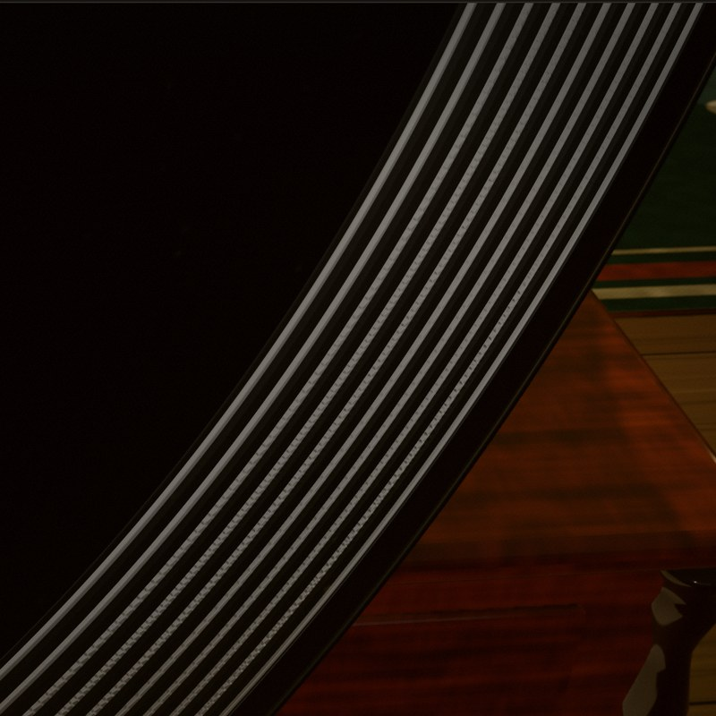
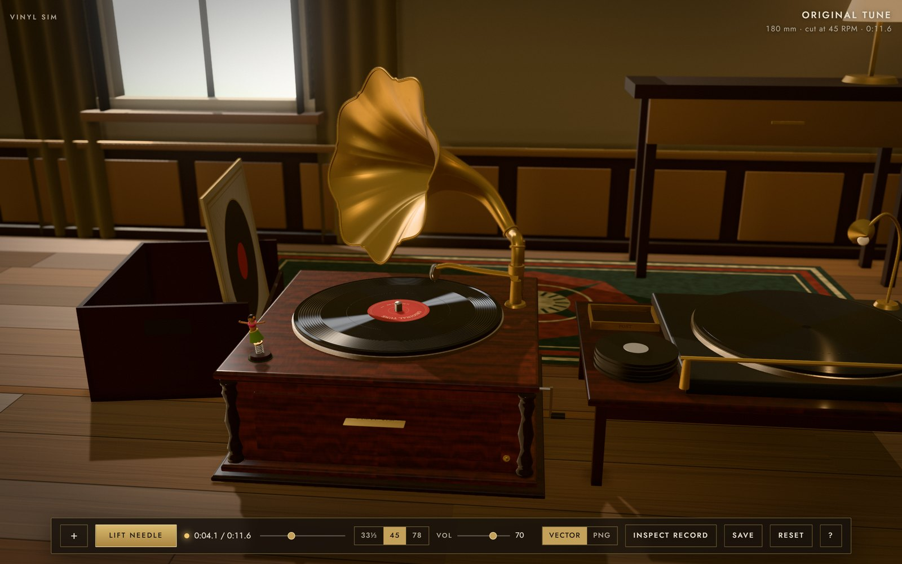

# Vinyl Sim

Vinyl Sim cuts a song into a 16-bit greyscale PNG that holds one spiral groove, then plays it back on a 3D phonograph by tracing that groove.

**[Play it in your browser](https://snazzygaz.github.io/vinyl-sim/room.html)** · [Player](https://snazzygaz.github.io/vinyl-sim/player.html) · [Cutter](https://snazzygaz.github.io/vinyl-sim/cutter.html) · [Run it locally](#run-it-locally)


*The Player playing the bundled record from its PNG (Source: PNG trace), needle down in the groove.*

## Cut, open, play

1. **Cut.** Give the Cutter a song, or use the bundled 11-second tune. It writes `name.png`, which is the record itself.
2. **Open.** In the Player or the Room, open the PNG. Add its `name.groove.wav` and `name.json` if you have them.
3. **Play.** Drop the needle.

On GitHub Pages, cutting and playing both happen in your browser and nothing is uploaded. Run locally, the same pages use the Python server instead.


*The Cutter after cutting the bundled tune: four files, and only the PNG is needed to play.*

## The groove is the data

<p>


</p>

*Left: an 18 mm-wide patch of `original-tune.png`, contrast stretched for display. Each bright line is one turn of the groove, and its wiggle is the sound. Right: the same record in Inspect.*

- **`name.png` carries the sound.** Each pixel's value is the depth of the disc at that point. The Player follows the spiral, measures how far the groove swings sideways, and turns that swing back into audio (Source: **PNG trace**).
- **`name.groove.wav` and `name.json` are a companion master.** They hold the same prepared groove as clean samples, saved at cut time. Source: **Vector** plays them, so you can compare them with the trace. A PNG on its own plays fine without them.
- **`name.preview.png` is just a picture.** It is 8-bit and does not play.
- **The 3D disc is an illustration.** Inspect shades the record with the PNG's real relief, so you are looking at the groove you heard, but the sound never comes from the rendering.

## The Room



*The Room: the whole app in one scene, with the lathe on the bench at the right.*

The Room puts cutting, playing and keeping records in one scene. Drop a song anywhere, or click the stack of blanks on the bench, and the lathe cuts it. A picture dropped with the song becomes its cover. Every record you cut or open is filed in the crate, and it is still there next visit in the same browser. Put a sleeve on the post tray to save the record's files.

A toy rides on the cabinet lid and dances to the music. The hula girl is the default, and a small brass pip on the cabinet front swaps in Garyck Arntzen's shiba.

## Controls

| To | Do this |
|---|---|
| Play a record from the crate | Drag its sleeve over the cabinet and let go when the rim glows. Or click: hover a sleeve to raise it, click to slide the record half out, then click the record again. Esc puts it back. |
| Start and stop | Use the **Drop/Lift needle** button or the tonearm. The position slider seeks. |
| Scratch | While it plays, hold the record and drag round the centre. |
| Inspect | With the needle up, click the record or use **Inspect record**. Drag to turn it, scroll to look closer, and press Esc to put it back. |
| Speed | Use the 33⅓, 45 and 78 buttons, or the RPM control for fine speed. |
| View | Right-drag to walk round, use the wheel to move closer, and press **Reset** to return to the default seat. |

The Room also has keys: Space for the needle, I to inspect, 1–3 and [ ] for speed, Home to reset the view, and **?** to list every key. **Picture** sets the render quality. Auto picks High, Balanced or Low for your GPU.

## Run it locally

You need Python 3.10+ and [FFmpeg](https://ffmpeg.org/) on your PATH. From the project folder:

```sh
python3 -m pip install -r requirements.txt   # numpy, scipy, Pillow
python3 serve.py --port 8765
```

Then open <http://127.0.0.1:8765/room>. The Cutter is at `/cutter` and the Player is at `/player`. On Windows you can double-click `start-windows.bat` instead.

The server stays on your computer, and Three.js is bundled, so nothing is fetched from the network. Finished cuts are kept in `output/` for 7 days; `--keep-days 0` keeps them all.

Tests: `python3 verify.py`, `python3 test-http.py`, and `node test-vinyl-core.cjs`, `test-player.cjs`, `test-player-pages.cjs`, `test-inspect-height.cjs`, `test-tags.cjs` (needs FFmpeg) and `test-view.mjs`.

## What it does and doesn't do

- **Mono only.** The groove swings sideways only, like a mono record. Stereo input is mixed down.
- **Lo-fi on purpose.** Audio is resampled to 16 kHz and band-limited, at most 6.5 kHz and lower towards the label, the way real inner grooves lose treble. The PNG trace is a digital stylus reading pixels, not a hi-fi transfer.
- **4:30 at most.** A longer song is cut to its first 4:30, because past that the spiral packs too tightly for the PNG to hold. Clips up to 40 s become a 180 mm disc (7-inch size), and anything longer becomes a 300 mm disc (12-inch size). Clips up to 2:00 are cut at 45 RPM, and longer ones at 33⅓.
- **Not RIAA.** A simple reversible treble lift stands in for the RIAA curve.
- **Your records live in this browser.** Clearing the site's data empties the crate.
- **The 3D view needs WebGL 2.** Without it, playback still works from the controls.

## How it maps to a real record

A cutting lathe carves one spiral groove into a spinning disc, and on a mono record the groove's sideways swing is the waveform. The Cutter does the same thing in pixels: brightness is depth, and the swing follows the sound. Because the disc turns at a fixed speed, the inner turns have less length for each second of sound. The PNG has the same problem with fewer pixels per wiggle near the label, so the end of a side sounds a little duller than the start, as on vinyl. The Player plays the stylus: it rides the spiral back out of the PNG.

## Credits

Made by [Garyck Arntzen](https://www.garyckarntzen.com/) · [@_mintydoge](https://x.com/_mintydoge).

Bundled: [Three.js](https://threejs.org/) r169 (MIT, `static/vendor/three/LICENSE.txt`), and the Jost and Manrope fonts (SIL Open Font License, `static/fonts/`). The Python packages in `requirements.txt` are installed separately under their own licences.
